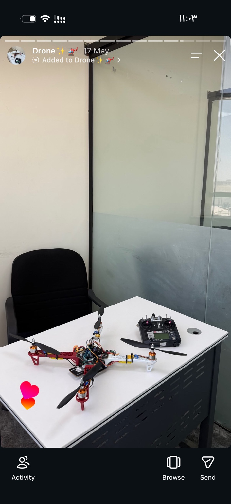

# مشروع درون رباعي باستخدام Arduino

**صاحب المشروع:** أنس إبراهيم المطيري  
**الحالة:** توثيق التجميع والعمل البرمجي؛ نجاح التشغيل والطيران غير موثّق هنا.

## فكرة المشروع

مشروع تعليمي لتجميع درون رباعي واستكشاف توصيل المحركات ووحدات التحكم بالسرعة ESC مع Arduino Uno. الصور توثّق الهيكل والتوصيلات والعمل داخل Arduino IDE، وتظهر إحداها خطأ تجميع سابقًا.

## محتويات المستودع

- صور المشروع الأصلية الثلاث.
- توثيق المكونات والتوصيلات المقترحة.
- مثال جديد لاختبار قناة محرك واحدة في كل مرة باستخدام الأوامر التسلسلية.
- تعليمات التشغيل وخطة تطوير لاحقة.

**الكود المرفق أُعدّ حديثًا لهذا المستودع، وليس نسخة مسترجعة من الكود الأصلي.** توزيع المنافذ D3 وD5 وD6 وD9 مبني على الكود الظاهر بالصورة ويجب التأكد منه فعليًا.

## حدود المشروع

الكود اختبار مكتبي للمحركات، ولا يحتوي على خوارزمية توازن أو PID أو قراءة جهاز التحكم أو طيران ذاتي. لا توجد نتائج طيران أو دقة أو قدرات ذكاء اصطناعي مثبتة. موديلات المحركات والبطارية وESC والحساسات تحتاج إلى توثيق.

## قبل التجربة

انزع جميع المراوح وثبّت الهيكل. افصل طاقة المحركات عند التوصيل والرفع، وراجع دليل ESC قبل اعتماد نبضات الاختبار. لا تغذِّ المحركات من Arduino ولا توصل البطارية مباشرة بمنفذ 5V. راجع [المكونات](docs/HARDWARE.md) و[خطوات الاختبار](docs/BENCH_TEST.md).

## البرمجة

افتح `firmware/esc_bench_test/esc_bench_test.ino` في Arduino IDE، واختر Arduino Uno والمنفذ الصحيح وثبّت مكتبة Servo الرسمية عند الحاجة. شغّل Verify أولًا. تعليمات الأوامر موجودة في ملف الاختبار.

اجتاز المثال فحص صياغة C++ باستخدام بدائل مبسطة لواجهات Arduino وServo فقط. لم يُجرَ بناء باستخدام حزمة Arduino الفعلية أو اختبار على العتاد؛ يلزم تنفيذهما قبل اعتماد الكود.

[English README](README.md) · [طريقة الرفع على GitHub](docs/GITHUB_UPLOAD.ar.md)
