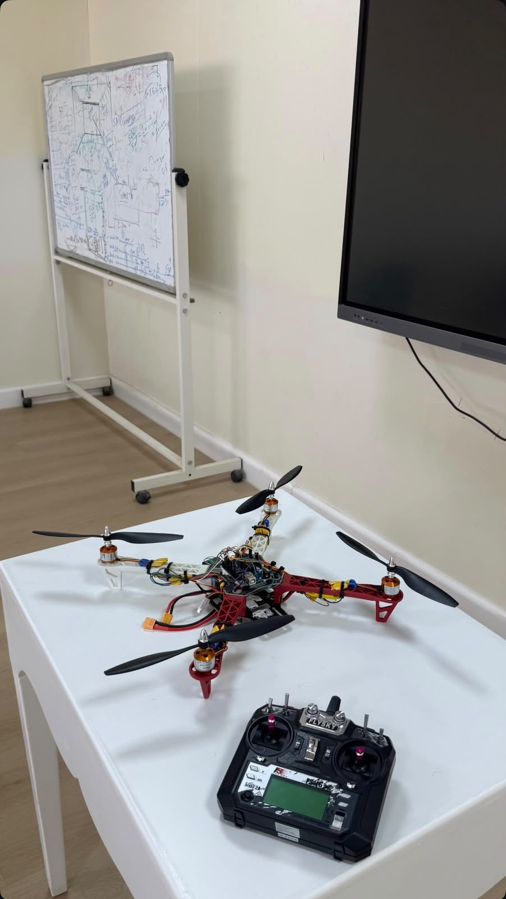
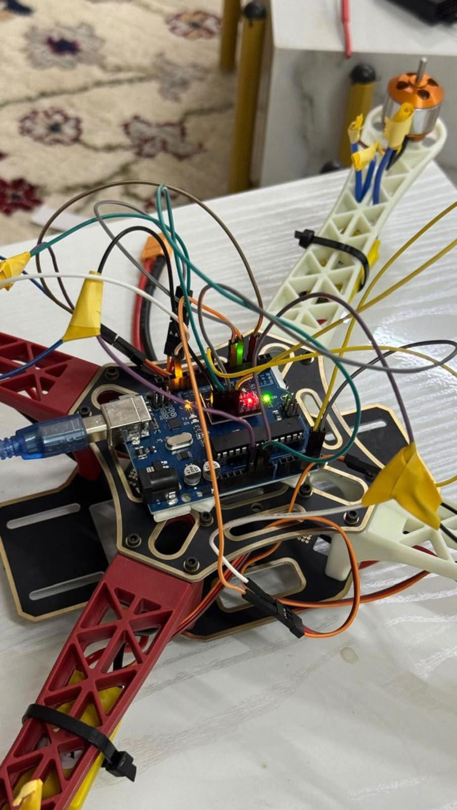
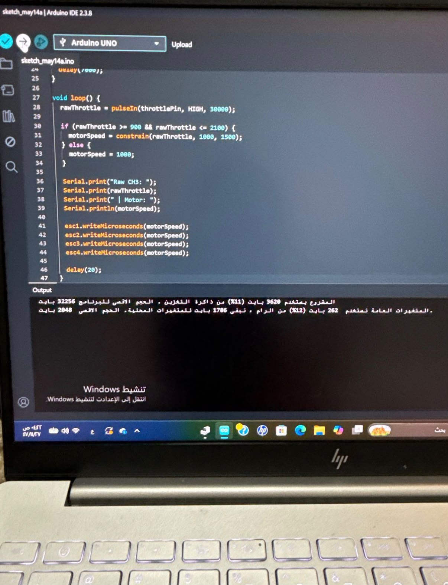
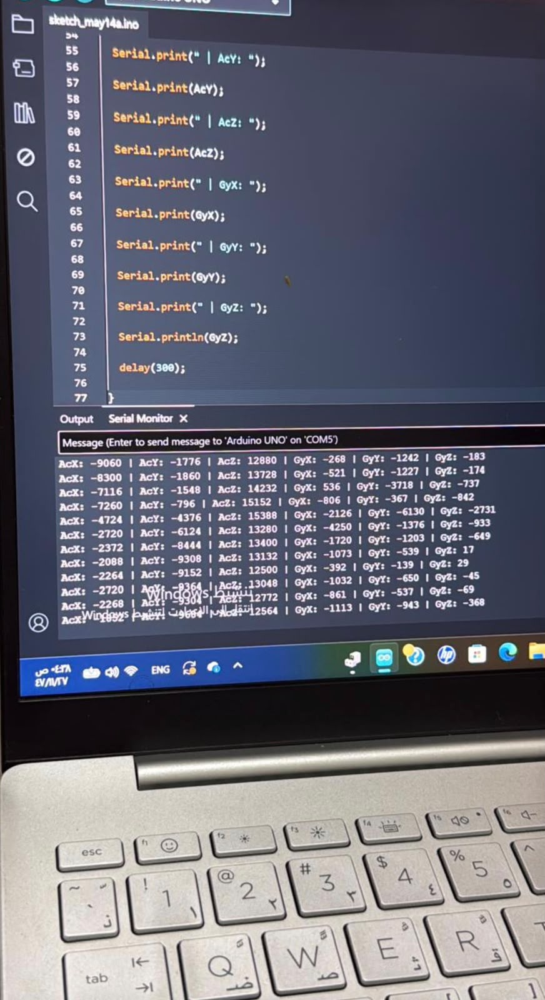

# مشروع درون رباعي باستخدام Arduino

مشروع عملي في الأنظمة المدمجة يجمع بين تجميع الدرون، وبرمجة Arduino، وتجارب التحكم بإشارات المحركات، وعرض بيانات التسارع والجيروسكوب.

**صاحب المشروع:** أنس إبراهيم المطيري  
**التقنيات:** Arduino Uno · C++ · Arduino IDE  
**التقدم الموثّق:** تجميع العتاد، ونتيجة تجميع كود سابق، وعرض قراءات الحساس في Serial Monitor.

[English](README.md) · [المكونات والتوصيلات](docs/HARDWARE.md) · [شرح التطوير](docs/DEVELOPMENT.md)

## فكرة المشروع

استكشاف بناء منصة درون رباعية تربط الهيكل والمحركات والإلكترونيات بالبرمجة العملية. يركّز التوثيق على تركيب المكونات، وتجارب إرسال أوامر الثروتل إلى وحدات ESC، ومراقبة بيانات الحساسات أثناء التطوير.

## العمل الموثّق بالصور

- تجميع الهيكل الأحمر والأبيض مع أربعة محركات والمراوح.
- تثبيت Arduino وسط الهيكل وتوصيله بالكمبيوتر.
- وجود جهاز تحكم يحمل علامة FlySky ضمن تجهيزات المشروع.
- كود مصوّر لقراءة نبضة الثروتل وإرسال الأمر إلى أربع قنوات ESC.
- نتيجة تجميع للكود المصوّر: 3,620 بايت للبرنامج و262 بايت للمتغيرات العامة.
- عرض قراءات محاور التسارع والجيروسكوب في Serial Monitor.

## الكود المرفق

المثال الموجود داخل `firmware/esc_bench_test/` أُعدّ للمستودع لاختبار محرك واحد في كل مرة بأوامر تسلسلية ومدة اختبار محدودة. وهو منفصل عن الكودين الظاهرين في الصور؛ النسخ الأصلية الكاملة لهما غير متوفرة هنا.

الكود المصوّر يرسل الأمر نفسه إلى المحركات الأربعة، ولا يثبت تطبيق خوارزمية توازن أو طيران مستقل. نجاح الطيران وتشغيل المستقبل ومعايرة الحساس لم تُثبت بالصور.

## معرض مراحل المشروع

### نظرة عامة على الدرون

الهيكل الرباعي بعد التجميع، مع المحركات والمراوح والإلكترونيات المركزية وجهاز تحكم يحمل علامة FlySky.

### تفاصيل لوحة التحكم والتوصيلات

لقطة مقرّبة للوحة Arduino وأسلاك التوصيل ومؤشرات الإضاءة وتوصيلات المحركات. موديلات الحساس والمستقبل تحتاج إلى توثيق.

### كود الثروتل ونتيجة التجميع

الكود الظاهر يقرأ نبضة الثروتل ويقيّد قيمة الأمر ثم يرسلها إلى قنوات ESC الأربع. تظهر نتيجة التجميع استخدام 3,620 بايت للبرنامج و262 بايت للمتغيرات العامة لهذا الكود المصوّر.

### قراءات الحساس في Serial Monitor

تعرض نافذة Serial Monitor قيماً متغيرة للمحاور AcX وAcY وAcZ وGyX وGyY وGyZ. الصورة توثّق عرض بيانات الحساس، ولا تحدد وحداتها أو معامل القياس أو المعايرة أو موديل الحساس.

## التشغيل والتطوير

انزع جميع المراوح وثبّت الهيكل قبل الاختبار. تحقّق من التوصيلات ومواصفات ESC، وافتح المثال في Arduino IDE واختر Arduino Uno والمنفذ الصحيح. اتبع [دليل الاختبار](docs/BENCH_TEST.md).

اجتاز المثال الجديد فحص صياغة C++ بواجهات مبسطة فقط؛ لم يُبنَ باستخدام حزمة Arduino الفعلية ولم يُختبر على العتاد أثناء إعداد المستودع. نتيجة التجميع المصوّرة تخص الكود السابق الظاهر في الصورة.

الخطوات القادمة: استرجاع الكود الأصلي، وتحديد المكونات، وتوثيق تجارب المستقبل والحساس والمحركات، ثم تطوير التحكم بالاتزان واختباره. [خطة التطوير](docs/ROADMAP.md).
