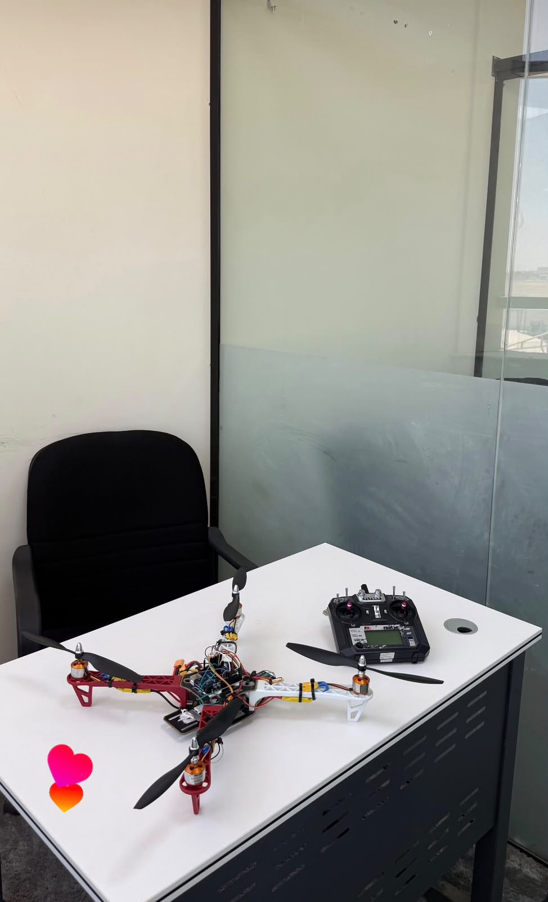
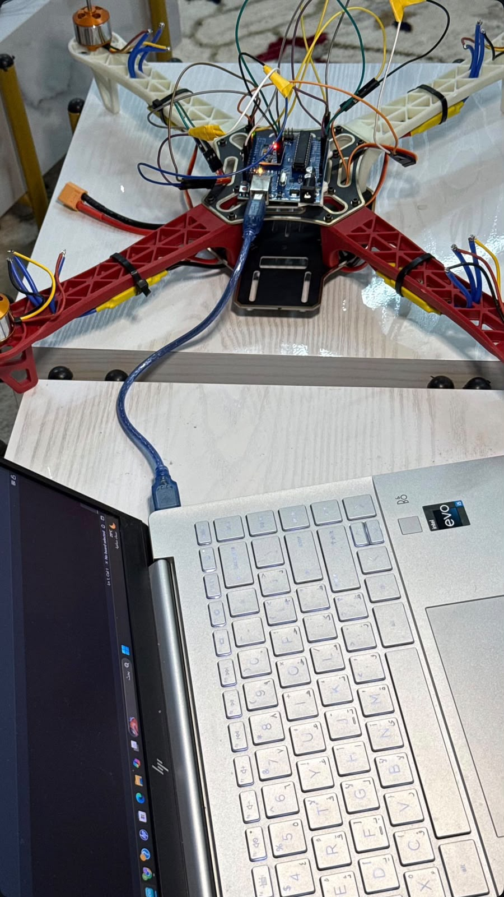

# Arduino Quadcopter Drone

A hands-on embedded systems project exploring quadcopter assembly, Arduino programming, ESC throttle signals, and inertial sensor data.

**Project owner:** Anas Ibrahim Al-Mutairi  
**Platform:** Arduino Uno · C++ · Arduino IDE  
**Documented progress:** Hardware assembly, historical sketch compilation output, and sensor readings in Serial Monitor.

[العربية](README.ar.md) · [Hardware](docs/HARDWARE.md) · [Development evidence](docs/DEVELOPMENT.md) · [Bench-test guide](docs/BENCH_TEST.md)

## About the project

This educational project connects mechanical assembly with embedded programming. It documents a four-motor drone platform, central Arduino electronics, radio-control hardware, throttle-control experiments, and acceleration/gyroscope data displayed through serial diagnostics.

The project demonstrates the workflow of assembling hardware, developing small diagnostic sketches, inspecting compiler output, and observing sensor data before advancing toward flight control.

## Documented work

| Area | Evidence in the project photos |
| --- | --- |
| Hardware assembly | Red-and-white quadcopter frame, four motors, propellers, and central electronics |
| Radio hardware | FlySky-branded transmitter alongside the assembled frame |
| Arduino integration | Board mounted on the frame with USB and jumper connections |
| Throttle programming | Code reads a pulse and writes a constrained command to four ESC channels |
| Historical compilation | Arduino IDE reports program and global-variable memory usage |
| Sensor diagnostics | Serial Monitor shows acceleration and gyroscope axis values |

The historical throttle sketch and sensor sketch are visible only in photographs; their complete original source files have not been recovered. The supplied `esc_bench_test.ino` is a separately prepared example, not a transcription of either sketch.

## Software in this repository

The [ESC bench-test example](firmware/esc_bench_test/esc_bench_test.ino) supports manual arming, selection of one motor channel, and a timed return to minimum throttle. The proposed signal pins are D3, D5, D6, and D9; confirm actual wiring before use.

The pictured throttle sketch sends the same command to all four channels. This does not establish attitude stabilization or independent flight-control mixing. Stable flight, receiver operation, calibrated sensor performance, and autonomous control are not established by these photos.

## Development gallery

### Quadcopter overview

The assembled four-arm frame with motors, propellers, central electronics, and a FlySky-branded radio transmitter.

### Workbench assembly

A second view of the red-and-white airframe and transmitter during the hardware integration stage.

### USB development setup

The Arduino board is mounted at the center of the frame and connected to a laptop by USB for development.

### Controller and wiring detail

A close-up of the central Arduino board, jumper wiring, indicator LEDs, and motor wiring. Exact sensor and receiver models remain to be documented.

### Throttle code and build output

The displayed sketch reads a throttle pulse, limits its command range, and writes the same pulse command to four ESC channels. The IDE reports 3,620 bytes of program storage and 262 bytes of global-variable memory for this historical sketch.

### Sensor readings in Serial Monitor

Serial Monitor displays changing AcX, AcY, AcZ, GyX, GyY, and GyZ values. The image documents sensor-data output; units, scale, calibration, and sensor model are not established by the screenshot.

## Repository guide

| Path | Contents |
| --- | --- |
| `firmware/esc_bench_test/` | New example for individual ESC bench tests |
| `docs/HARDWARE.md` | Components and proposed signal connections |
| `docs/DEVELOPMENT.md` | Explanation of the photographed code and sensor output |
| `docs/BENCH_TEST.md` | Setup, serial commands, and testing limitations |
| `docs/ROADMAP.md` | Remaining development milestones |
| `images/` | Six updated project photographs |

## Getting started

1. Remove every propeller and secure the frame before powered bench testing.
2. Confirm ESC protocol, voltage ratings, signal range, and wiring against its manual.
3. Open `firmware/esc_bench_test/esc_bench_test.ino` in Arduino IDE.
4. Select Arduino Uno and the correct port; install the official Servo library if needed.
5. Verify and upload with motor power disconnected, then follow the [bench-test procedure](docs/BENCH_TEST.md).

## Validation and next steps

The new bench example passed a host C++ syntax check using simplified Arduino/Servo stubs. It has not been built with the actual Arduino toolchain or physically tested during repository preparation. The historical build statistics in the gallery apply to the photographed sketch only.

Next steps include recovering the original firmware, identifying component models, validating receiver and sensor behavior, and developing and testing an attitude-control system. See the [roadmap](docs/ROADMAP.md).

## References

- [Official Arduino Servo library](https://docs.arduino.cc/libraries/servo/)
- [Official Servo source](https://github.com/arduino-libraries/Servo)
- [Arduino Uno Rev3 documentation](https://docs.arduino.cc/hardware/uno-rev3/)

No third-party library source is bundled. No software license has been assigned; confirm ownership and any team/course requirements before selecting one.
