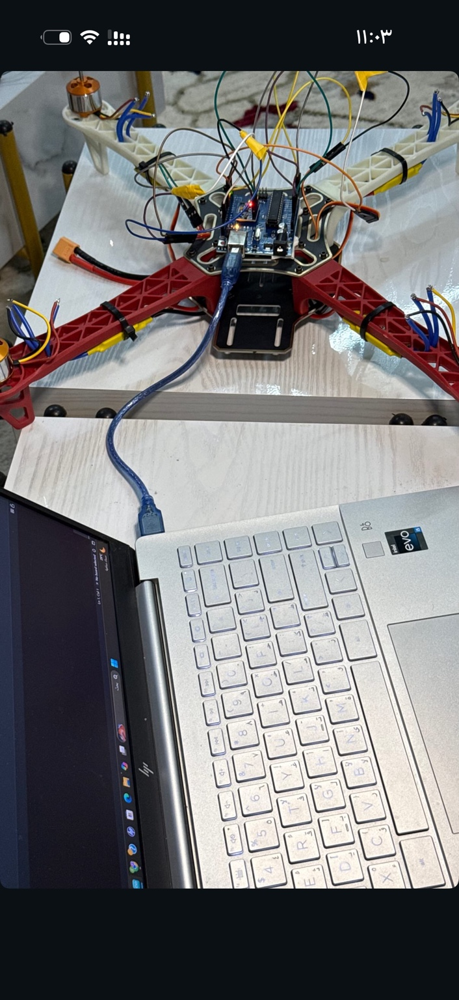
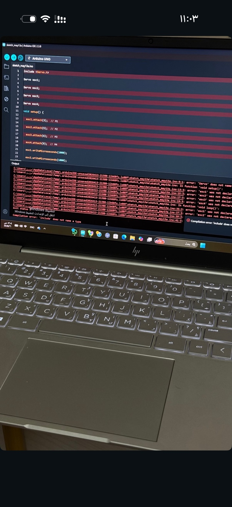

# Arduino Quadcopter Drone

An educational quadcopter hardware project documenting assembly, Arduino programming, and ESC motor-control experiments.

**Project owner:** Anas Ibrahim Al-Mutairi  
**Status:** Hardware assembly documented; hardware and flight performance not verified in this repository.

[العربية](README.ar.md) · [Hardware & wiring](docs/HARDWARE.md) · [Bench test](docs/BENCH_TEST.md) · [Development roadmap](docs/ROADMAP.md)

## Overview

This project brings together a four-arm drone frame, four brushless motors, electronic speed controllers (ESCs), an Arduino Uno, and a radio transmitter shown in the project photos. It documents a hands-on exploration of embedded systems and drone hardware integration.

The supplied Arduino sketch is a **new bench-test example prepared for this repository**, based on the visible pin assignments. It is not a recovered copy of the original firmware. It tests one ESC channel at a time with manual serial commands and a timed return to minimum throttle.

## What is documented

- Physical assembly and wiring experiments, supported by three original photographs.
- Arduino IDE development; one photograph records an earlier compilation error.
- A proposed signal-pin map: D3, D5, D6, D9.
- An example sketch with manual arming, one-motor selection, and a two-second test limit.

## What is not yet verified

Exact ESC/motor/battery models, sensor configuration, receiver wiring, ESC calibration, successful hardware execution, stable flight, and autonomous flight. The example has no attitude estimation, PID stabilization, receiver decoding, or flight-control mixing. No AI capability is claimed.

## Repository contents

| Path | Purpose |
| --- | --- |
| `firmware/esc_bench_test/esc_bench_test.ino` | New ESC bench-test example |
| `docs/HARDWARE.md` | Components, assumptions, proposed connections |
| `docs/BENCH_TEST.md` | Setup, commands, and limitations |
| `docs/ROADMAP.md` | Planned work and evidence checklist |
| `docs/GITHUB_UPLOAD.ar.md` | Arabic upload instructions and profile description |
| `images/` | Original project photographs |

## Quick start

1. Remove **all propellers** and secure the frame. Disconnect motor power while checking wiring.
2. Read the ESC manual and confirm the proposed pulse widths and wiring are appropriate.
3. Install the Arduino AVR Boards package and the official Servo library if missing.
4. Open `firmware/esc_bench_test/esc_bench_test.ino` in Arduino IDE.
5. Choose Arduino Uno and the correct port; use Verify, then Upload with ESC power disconnected.
6. Follow [the bench-test procedure](docs/BENCH_TEST.md). Do not use this sketch for flight.

## Project photos

### Arduino and wiring

### Development snapshot

This historical photograph records a compilation failure; it is not evidence of successful execution.

## Engineering topics

Embedded C++, Arduino development, ESC pulse signals, hardware integration, serial diagnostics, and incremental hardware testing.

## Verification

The example received a host C++ syntax check with lightweight Arduino/Servo stubs. This does not verify the actual Arduino core, Servo library linkage, pulse timing, or hardware behavior. No physical test or flight test was performed while preparing this package. Build it in Arduino IDE before use and record actual observations separately.

## References

- [Official Arduino Servo library](https://docs.arduino.cc/libraries/servo/)
- [Official Servo source and API](https://github.com/arduino-libraries/Servo)
- [Arduino Uno Rev3 documentation](https://docs.arduino.cc/hardware/uno-rev3/)

No third-party library source is bundled. No software license is assigned in this package; choose one after confirming project ownership and any team or course requirements.
